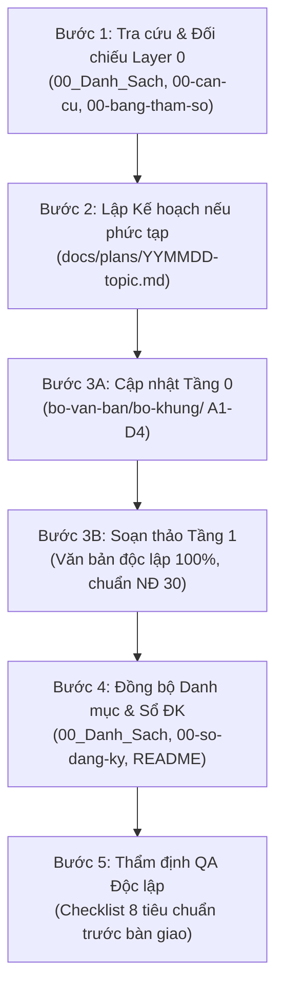

# AGENTS.md – HƯỚNG DẪN DÀNH CHO AI AGENT (AI CODING & LEGAL CONTEXT)

- **Date:** 2026-10-16
- **Author:** System Architecture & Legal Ops Team
- **Status:** Active / Production Standard
- **Scope:** Toàn bộ Repository `QL_SM` (Hệ thống Văn bản Quản lý & Vận hành Doanh nghiệp)

---

## 1. TỔNG QUAN DỰ ÁN & BỐI CẢNH DOANH NGHIỆP

Repository `QL_SM` là **Hệ thống Văn bản Quản lý, Pháp lý và Vận hành Chuẩn mực** dành cho doanh nghiệp hoạt động trong lĩnh vực **Lắp dựng kết cấu thép và thi công nhà xưởng công nghiệp** tại Việt Nam.

### 1.1. Đặc thù và hồ sơ doanh nghiệp
- **Loại hình & Quy mô:** Công ty TNHH. Khối văn phòng, kỹ thuật và nhân sự dài hạn nòng cốt: ~10 người; lực lượng công nhân thi công huy động linh hoạt theo từng công trình (ký HĐLĐ thời vụ hoặc giao khoán tổ đội độc lập). Đã thành lập Công đoàn cơ sở.
- **Địa bàn hoạt động:** Trụ sở chính tại TP. Hồ Chí Minh (Vùng I), các công trình thi công diễn ra trên cả nước. Công ty áp dụng mức **lương tối thiểu Vùng I làm sàn chung** cho toàn bộ lao động nhằm tối ưu quản trị và loại trừ rủi ro tranh chấp địa bàn.
- **Vai trò trong chuỗi dự án:** Chủ yếu là **Nhà thầu phụ thi công xây lắp** (hoặc tổng thầu phần kết cấu thép), thường xuyên làm việc với các Tổng thầu lớn, Chủ đầu tư và tổ chức tư vấn giám sát có yêu cầu khắt khe về HSE / ISO 45001.
- **Hai dạng hợp đồng chính:**
  1. *Dạng 1: Chỉ thi công* (Chủ đầu tư / Tổng thầu cấp vật tư; rủi ro quản trị hao hụt, giao nhận, chậm tiến độ).
  2. *Dạng 2: Gồm vật tư* (Công ty mua vật tư thành phẩm hoặc thuê xưởng gia công cơ khí bên ngoài theo quy trình STT 84; rủi ro biến động giá thép, chất lượng nghiệm thu xưởng, công nợ).
- **Tính chất lao động & Mối nguy nghiêm ngặt:** Công việc tiềm ẩn rủi ro tai nạn cao: làm việc trên cao (> 2m), cẩu lắp kết cấu thép nặng / siêu trường, hàn cắt sinh nhiệt, giàn giáo, an toàn điện công trường.

---

## 2. KIẾN TRÚC HỆ THỐNG VĂN BẢN (MÔ HÌNH 2 TẦNG)

Hệ thống được thiết kế theo **Mô hình kiến trúc 2 tầng (2-Tier Architecture)** kết hợp với **Layer 0 (Công cụ quản trị nguồn)**:

```
[ LAYER 0: Công cụ Quản trị Nguồn & Tham số ] (bo-van-ban/)
       ├── 00-bang-tham-so.md       (Tham số nguồn: Công ty, Pháp luật, Nội bộ)
       ├── 00-can-cu-phap-ly.md      (Hệ thống luật hiện hành đối chiếu đến 10/2026)
       ├── 00_Danh_Sach_Van_Ban.md  (Danh mục chủ điều phối toàn bộ hệ thống)
       ├── 00-so-dang-ky-van-ban.md  (Sổ theo dõi phiên bản, ban hành, rà soát)
       ├── 00_Ma_Data.md            (Bảng quy chuẩn mã placeholder <<MA_DATA>>)
       └── 00-quyet-dinh-ban-hanh.md (Quyết định ban hành khung toàn hệ thống)
                          │
         ┌────────────────┴────────────────┐
         ▼                                 ▼
[ TẦNG 0: BỘ KHUNG THIẾT KẾ ]    [ TẦNG 1: VĂN BẢN LƯU HÀNH THỰC TẾ ]
  (bo-van-ban/bo-khung/ A1–D4)     (I -> VI, mau-nha-nuoc/ 75+ văn bản)
  - Căn cứ lập luận & logic        - Độc lập bản in 100% khi xuất Word/PDF
  - Quản trị rủi ro pháp lý        - Chuẩn thể thức hành chính NĐ 30/2020
  - Quy trình luân chuyển nội bộ   - Tích hợp sẵn Quyết định ban hành (7 quy chế)
  - Hướng dẫn kiểm soát nghiệp vụ  - TUYỆT ĐỐI KHÔNG chứa bài viết hướng dẫn
```

### 2.1. Tầng 0 – Bộ khung thiết kế kiến trúc (`bo-van-ban/bo-khung/`)
- Gồm 14 tài liệu thiết kế nguồn từ A1 đến D4.
- **Nhiệm vụ:** Giải thích nguyên lý *"vì sao như vậy"*, hướng dẫn quản trị rủi ro pháp lý, phân định trách nhiệm các phòng ban, quy trình luân chuyển chứng từ nội bộ và hướng dẫn kiểm soát hồ sơ.

### 2.2. Tầng 1 – Danh mục văn bản thực thi ban hành độc lập (75+ văn bản)
- Phân loại theo các thư mục chuyên môn:
  - `I_Hop_Dong_Nhan_Su/`: Hợp đồng lao động, nhân sự, tuyển dụng, kỷ luật, hồ sơ công nhân, giao khoán (STT 01a–15, 82, 85).
  - `II_Noi_Quy/`: Nội quy lao động, nội quy an toàn dự án, hồ sơ đăng ký NQLĐ (STT 16–21).
  - `III_Luong_Thuong_Ke_Toan/`: Quy chế lương, thưởng KPI dự án, làm thêm giờ, chứng từ tạm ứng/quyết toán (STT 22–31).
  - `IV_HSE_An_Toan_TNLD/`: Sổ tay HSE, nhận diện mối nguy, giấy phép làm việc nguy hiểm, ứng cứu khẩn cấp, điều tra TNLĐ, bảo hiểm công trường (STT 32–62, 83).
  - `V_To_Chuc_Phan_Quyen/`: Cơ cấu tổ chức, phân quyền điều hành, bảo vệ dữ liệu cá nhân, hủy tài liệu (STT 63–66).
  - `VI_Thi_Cong_Kinh_Doanh/`: Quy trình thi công, nghiệm thu, kinh doanh, mua sắm vật tư, gia công ngoài, quy chế dân chủ (STT 67–81, 84).
  - `mau-nha-nuoc/`: Biểu mẫu Nhà nước số hóa quy chuẩn (TT 133/2016, NĐ 145/2020, NĐ 39/2016, NĐ 207/2026...).

---

## 3. CÁC NGUYÊN TẮC BẤT DI BẤT DỊCH CHO AI AGENT

Khi phân tích, soạn thảo, chỉnh sửa hoặc kiểm tra văn bản trong repository này, AI Agent **BẮT BUỘC** phải tuân thủ nghiêm ngặt 6 nguyên tắc cốt lõi:

### 3.1. Nguyên tắc 1: Tách bạch tuyệt đối Tầng 0 và Tầng 1
- **Văn bản Tầng 1 phải độc lập bản in 100%:** Khi chuyển đổi sang file in (.docx / .pdf), văn bản phải mang đầy đủ giá trị pháp lý độc lập (Tiêu ngữ, Quốc hiệu, Tên văn bản, Căn cứ pháp lý, Nội dung điều khoản, Đại diện ký tên đóng dấu).
- **Tuyệt đối KHÔNG chèn bài viết hướng dẫn:** Không đưa bài viết hướng dẫn nghiệp vụ nội bộ, giải thích lý thuyết, cẩm nang hay tutorial vào văn bản ban hành Tầng 1. Mọi hướng dẫn quản trị rủi ro phải nằm ở Tầng 0 (`bo-khung/`).
- **Không viện dẫn file nội bộ:** Văn bản Tầng 1 không được chứa link markdown tương đối (như `../bo-khung/...`) hoặc viện dẫn file nội bộ không có giá trị đối ngoại.

### 3.2. Nguyên tắc 2: Tuân thủ quy chuẩn mã dữ liệu `<<MA_DATA>>`
- Toàn bộ các vị trí thông tin biến động phải sử dụng thống nhất mã placeholder dạng `<<MA_DATA>>` (chữ in hoa, gạch dưới, kẹp giữa hai dấu ngoặc nhọn kép) theo đúng `bo-van-ban/00_Ma_Data.md` và `bo-van-ban/00-bang-tham-so.md`.
- Ví dụ: `<<CTY_TEN>>`, `<<CTY_MST>>`, `<<CTY_DC>>`, `<<NLD_HO_TEN>>`, `<<CT_TEN>>`, `<<VB_SO>>`, `<<VB_NGAY>>`.
- **Cấm tự ý bịa mã mới** hoặc để sót các ký hiệu cũ như `<CTY>`, `{{TEN_CONG_TY}}` (chỉ dùng riêng trong bảng tham số nguồn), hoặc để khoảng trống dấu ba chấm không có chủ đích.
- Các ô biểu mẫu vận hành (bảng trống, dòng kẻ ký tên của nhân sự thực tế khi in ra điền tay) được giữ nguyên định dạng bảng/dòng kẻ chấm.

### 3.3. Nguyên tắc 3: Cập nhật pháp luật mới nhất (Mốc đối chiếu tháng 10/2026)
AI Agent phải luôn đối chiếu với hệ thống pháp luật hiện hành và **TUYỆT ĐỐI KHÔNG** sử dụng các văn bản đã hết hiệu lực:
- **An toàn & Thi công Xây dựng:**
  - Áp dụng: **Luật Xây dựng 2025** (135/2025/QH15, hiệu lực 01/07/2026), **Nghị định 207/2026/NĐ-CP** (hiệu lực 01/07/2026), **Thông tư 32/2026/TT-BXD**.
  - **BỊ BÃI BỎ / CẤM DÙNG:** Nghị định 06/2021/NĐ-CP; các Điều 2–9 và Điều 19 của Thông tư 10/2021/TT-BXD (đã bị Thông tư 32/2026 bãi bỏ từ 01/07/2026).
- **Lao động & Xử phạt vi phạm hành chính:**
  - Áp dụng: Bộ luật Lao động 2019; **Nghị định 283/2026/NĐ-CP** (hiệu lực từ 10/09/2026) về xử phạt vi phạm hành chính trong lĩnh vực lao động, BHXH.
  - **BỊ THAY THẾ / CẤM DÙNG:** Nghị định 12/2022/NĐ-CP (đã hết hiệu lực từ 10/09/2026).
  - Lương tối thiểu: **Nghị định 293/2025/NĐ-CP** (Vùng I: 5.310.000 đ/tháng từ 01/01/2026).
  - Ngày nghỉ lễ: **Nghị quyết 28/2026/QH16** bổ sung Ngày Văn hóa Việt Nam (24/11) hưởng nguyên lương (tổng 12 ngày lễ, Tết).
  - Đăng ký lao động: **Luật Việc làm 2025** (74/2025/QH15) & **Nghị định 318/2025/NĐ-CP** (hiệu lực 01/01/2026); Sổ quản lý lao động (STT 82).
  - BHXH: **Luật BHXH 2024** (HĐLĐ từ đủ 01 tháng trở lên thuộc diện đóng BHXH bắt buộc).
- **Bảo hiểm công trường bắt buộc:**
  - Điều 10 Luật Xây dựng 2025 (nhà thầu thi công bắt buộc mua bảo hiểm cho người lao động trên công trường và bảo hiểm trách nhiệm dân sự bên thứ ba); **Nghị định 67/2023/NĐ-CP** sửa đổi bởi **Nghị định 220/2026/NĐ-CP**.
- **Kế toán Doanh nghiệp SME:**
  - Áp dụng: **Thông tư 133/2016/TT-BTC** (đang áp dụng đồng bộ trong hệ thống biểu mẫu kế toán STT 12, 27, 30...). *Lưu ý:* Thông tư 99/2025/TT-BTC chỉ thay thế Thông tư 200/2014, không thay thế Thông tư 133/2016.
- **Bảo vệ Dữ liệu Cá nhân:**
  - **Luật Bảo vệ dữ liệu cá nhân 2025** (91/2025/QH15) và **Nghị định 356/2025/NĐ-CP** (hiệu lực 01/01/2026, thay thế Nghị định 13/2023/NĐ-CP).

### 3.4. Nguyên tắc 4: Ranh giới pháp lý Lao động, Giao khoán & HSE
- **Ranh giới HĐLĐ vs Giao khoán (Điều 13 BLLĐ 2019):**
  - Hợp đồng lao động (STT 01a, 01b, 01c, 02): Áp dụng khi quản lý theo thời giờ làm việc, chấm công, chịu sự quản lý, chỉ đạo trực tiếp của Công ty; phải đóng BHXH bắt buộc nếu hợp đồng từ đủ 1 tháng trở lên.
  - Hợp đồng giao khoán việc / nhân công (STT 85): Chỉ khoán sản phẩm/khối lượng hoàn thành độc lập (tấn, m², cụm chi tiết); ký với Người đại diện có Giấy ủy quyền của 100% thợ; thanh toán không dùng tiền mặt kèm bảng kê phân chia tiền công và cam kết thuế TNCN. **Tuyệt đối không dùng giao khoán để che giấu quan hệ lao động nhằm trốn BHXH.**
- **Nguyên tắc an toàn (Không "khoán trắng" HSE):**
  - Dù là công nhân công ty hay thợ nhận khoán: 100% người làm công việc nguy hiểm trên cao / cẩu lắp phải có **Thẻ an toàn Nhóm 3** còn hiệu lực và có **xác nhận bảo hiểm công trường**.
  - Quy tắc cứng: *Không HĐLĐ/HĐ khoán hợp lệ + Không thẻ an toàn còn hạn + Không bảo hiểm = Không vào công trường*.
- **Chế tài kỷ luật:**
  - Nghiêm cấm mọi hình thức phạt tiền, trừ lương công nhân trái pháp luật lao động (Điều 127 BLLĐ 2019). Xử lý vi phạm thông qua quy trình kỷ luật chính thức (STT 15a–15d) hoặc phạt vi phạm hợp đồng kinh tế/giao khoán.

### 3.5. Nguyên tắc 5: Quy chuẩn thể thức văn bản hành chính (Nghị định 30/2020/NĐ-CP)
- Đầy đủ Quốc hiệu, Tiêu ngữ chuẩn.
- **Vị trí căn cứ pháp lý chuẩn:**
  - *Văn bản hành chính, quyết định, biên bản:* Đặt ngay dưới tên loại và trích yếu, trước nội dung chính, trình bày bằng chữ in nghiêng.
  - *Hợp đồng, thỏa thuận:* Đặt ngay sau tiêu đề hợp đồng, trước phần giới thiệu các bên.
  - *Quy chế, quy trình:* Có thể đặt tại Điều 1 (Căn cứ pháp lý và phạm vi điều chỉnh).
- **Tích hợp Quyết định ban hành:** 7 quy chế cốt lõi (STT 08, 22, 23, 32, 63, 64, 78) tích hợp sẵn Quyết định ban hành độc lập của Giám đốc ở trang đầu văn bản.

### 3.6. Nguyên tắc 6: Quy chuẩn đặt tên tệp và tài liệu
- Tệp văn bản lưu hành: `<STT hai chữ số>_<Ten_Khong_Dau>.md` (ví dụ: `01b_HDLD_Thoi_Vu_Cong_Trinh.md`, `85_Bo_Ho_So_Giao_Khoan_Nhan_Cong.md`).
- Kế hoạch / Đề xuất trong `docs/`: Tuân thủ chuẩn `documentation-rules`:
  - Kế hoạch: `docs/plans/YYMMDD-topic.md` (ví dụ: `docs/plans/261016-bo-sung-bo-ho-so-giao-khoan.md`).
  - Đề xuất: `docs/proposals/YYMMDD-topic.md`.
  - Bắt buộc có metadata: Date, Author, Status.

---

## 4. QUY TRÌNH TÁC NGHIỆP CHUẨN CỦA AGENT (SOP)

Khi được yêu cầu soạn thảo văn bản mới, sửa đổi hoặc chuẩn hóa văn bản hiện có, Agent thực hiện theo quy trình 5 bước sau:



### Bước 1: Tra cứu & Đối chiếu Layer 0
- Đọc `bo-van-ban/00_Danh_Sach_Van_Ban.md` để xác định số thứ tự (STT), loại văn bản, đợt triển khai và liên kết tương ứng.
- Đọc `bo-van-ban/00-can-cu-phap-ly.md` và `bo-van-ban/00-bang-tham-so.md` để lấy đúng căn cứ pháp lý hiện hành và tham số quy chuẩn.
- Đọc `bo-van-ban/00_Ma_Data.md` để sử dụng đúng mã placeholder.

### Bước 2: Lập Kế hoạch (Plan) nếu phạm vi rộng
- Với các nhiệm vụ tạo mới bộ hồ sơ, tái cấu trúc hoặc thay đổi nhiều văn bản, tạo file kế hoạch tại `docs/plans/YYMMDD-topic.md` với đầy đủ metadata: `Date`, `Author`, `Status`, `Branch`.
- Xác định rõ nhiệm vụ phân chia, ranh giới Tầng 0 và Tầng 1.

### Bước 3: Triển khai 2 Tầng đồng bộ
1. **Tầng 0 (`bo-khung/`):** Cập nhật tài liệu khung tương ứng để ghi nhận nguyên tắc kiến trúc, căn cứ lập luận, quản trị rủi ro pháp lý và quy trình chứng từ.
2. **Tầng 1 (Văn bản thực thi):** Soạn thảo tệp văn bản độc lập 100%, đúng thể thức NĐ 30/2020/NĐ-CP, dùng mã `<<MA_DATA>>`, không chèn bài viết hướng dẫn.

### Bước 4: Đồng bộ Danh mục và Sổ đăng ký
- Cập nhật dòng tương ứng tại `bo-van-ban/00_Danh_Sach_Van_Ban.md` (STT, Tên, Loại, Trạng thái ●/▲/■, Đợt, Link, Ghi chú pháp lý).
- Ghi nhận nhật ký rà soát tại `bo-van-ban/00-so-dang-ky-van-ban.md`.
- Cập nhật `README.md` nếu có thay đổi cơ cấu tổng thể hoặc số lượng văn bản.

### Bước 5: Thẩm định QA & Báo cáo kết quả
- Rà soát lại theo Checklist ở Mục 6.
- Báo cáo tóm tắt cho người dùng về các thay đổi đã thực hiện và các điểm cần lưu ý.

---

## 5. BẢN ĐỒ CẤU TRÚC THƯ MỤC REPOSITORY

```txt
QL_SM/
├── AGENTS.md                                # Cẩm nang & Quy chuẩn vận hành cho AI Agent
├── README.md                                # Tổng quan mục tiêu, danh mục & rà soát hệ thống
├── .editorconfig / .prettierrc              # Cấu hình format mã nguồn & markdown
├── .gitignore                               # Bỏ qua file nháp, .backup/, tệp tạm office
├── bo-van-ban/                              # LAYER 0 & TẦNG 0 KIẾN TRÚC
│   ├── 00-bang-tham-so.md                   # Bảng tham số nguồn tập trung (Phần I, II, III)
│   ├── 00-can-cu-phap-ly.md                 # Căn cứ pháp luật đối chiếu đến 10/2026
│   ├── 00-so-dang-ky-van-ban.md             # Sổ đăng ký & nhật ký phiên bản văn bản
│   ├── 00_Danh_Sach_Van_Ban.md             # Danh mục chủ điều phối toàn bộ hệ thống
│   ├── 00_Ma_Data.md                       # Danh mục mã dữ liệu chuẩn <<MA_DATA>>
│   ├── 00-quyet-dinh-ban-hanh.md            # Quyết định ban hành khung toàn hệ thống
│   ├── 00-README-huong-dan-ban-hanh.md      # Cẩm nang hướng dẫn ban hành văn bản
│   └── bo-khung/                            # TẦNG 0: 14 TÀI LIỆU THIẾT KẾ KIẾN TRÚC
│       ├── A1-bo-hop-dong-ho-so-nhan-su.md
│       ├── A2-noi-quy-lao-dong.md
│       ├── A3-quy-che-luong-thuong-kpi.md
│       ├── A4-quy-trinh-vong-doi-cong-nhan.md
│       ├── B1-so-tay-hse.md
│       ├── B2-ho-so-an-toan-cong-trinh.md
│       ├── B3-quy-trinh-tai-nan-su-co.md
│       ├── B4-dieu-khoan-tong-thau-va-bao-hiem.md
│       ├── C1-quy-che-to-chuc-phan-quyen.md
│       ├── C2-quy-che-du-lieu-va-luu-tru.md
│       ├── D1-quy-trinh-du-an-thi-cong-nghiem-thu.md
│       ├── D2-quy-trinh-kinh-doanh.md
│       ├── D3-quy-trinh-tai-chinh-ke-toan.md
│       └── D4-quy-che-dan-chu-va-doi-thoai.md
├── I_Hop_Dong_Nhan_Su/                      # TẦNG 1: NHÓM I - HỢP ĐỒNG & NHÂN SỰ
│   ├── 01a_HDLD_Ngan_Han_Duoi_1_Thang.md
│   ├── 01b_HDLD_Thoi_Vu_Cong_Trinh.md
│   ├── 01c_HDLD_Xac_Dinh_Thoi_Han_12_Thang_Tho_Nong_Cot.md
│   ├── 02_HDLD_Khong_Xac_Dinh_Thoi_Han_Van_Phong.md
│   ├── 03_Thu_Moi_Thu_Viec_Van_Phong.md
│   ├── 04_Thoa_Thuan_Cham_Dut_HDLD_va_Bien_Ban_Thanh_Ly.md
│   ├── 05_Cam_Ket_Bao_Mat_va_Dong_Y_Xu_Ly_Du_Lieu_Ca_Nhan.md
│   ├── 06_Phu_Luc_HDLD.md
│   ├── 07_Checklist_Ho_So_Nhan_Su.md
│   ├── 08_Quy_Che_Dieu_Hanh_Nhan_Su_va_Vong_Doi_Cong_Nhan.md
│   ├── 09_Quyet_Dinh_Dieu_Dong_Den_Cong_Truong.md
│   ├── 10_Don_Xin_Nghi_Khong_Huong_Luong.md
│   ├── 11_Quyet_Dinh_Cho_Nghi_Khong_Huong_Luong.md
│   ├── 13_Quyet_Dinh_Chi_Dinh_Nguoi_Phu_Trach.md
│   ├── 15a_Bien_Ban_Vi_Pham.md ... 15d_Quyet_Dinh_Xu_Ly_Ky_Luat.md
│   ├── 82_So_Quan_Ly_Lao_Dong.md
│   └── 85_Bo_Ho_So_Giao_Khoan_Nhan_Cong.md
├── II_Noi_Quy/                              # TẦNG 1: NHÓM II - NỘI QUY LAO ĐỘNG & AN TOÀN
│   ├── 16_Noi_Quy_Lao_Dong.md
│   ├── 17_Quyet_Dinh_Ban_Hanh_Noi_Quy.md
│   ├── 18_Bien_Ban_Lay_Y_Kien_BCH_Cong_Doan_ve_Noi_Quy.md
│   ├── 20_Phieu_Xac_Nhan_Pho_Bien_Noi_Quy.md
│   └── 21_Noi_Quy_An_Toan_Cong_Truong.md
├── III_Luong_Thuong_Ke_Toan/               # TẦNG 1: NHÓM III - TIỀN LƯƠNG, KPI, KẾ TOÁN
│   ├── 22_Quy_Che_Tien_Luong_Thuong_Phu_Cap_2026.md
│   ├── 23_Quy_Che_Luong_KPI_Du_An_2026.md
│   ├── 25_Phieu_Dang_Ky_Lam_Them_Gio.md
│   ├── 26_Bien_Ban_Danh_Gia_Cham_Thuong_An_Toan.md
│   ├── 27_Phieu_Chi_Mau_02_TT.md
│   ├── 28_Phieu_Luong_Ca_Nhan.md
│   ├── 29_Quy_Trinh_Tai_Chinh_Ke_Toan_Cong_Trinh.md
│   └── 31_Bang_Tong_Hop_Quyet_Toan_Chi_Phi_Cong_Trinh.md
├── IV_HSE_An_Toan_TNLD/                     # TẦNG 1: NHÓM IV - SỔ TAY HSE, AN TOÀN, TNLĐ
│   ├── 32_So_Tay_HSE.md
│   ├── 33_Chinh_Sach_An_Toan_Suc_Khoe_Moi_Truong.md
│   ├── 34_Bang_Nhan_Dien_Moi_Nguy_Danh_Gia_Rui_Ro.md
│   ├── 35_Ke_Hoach_ATVSLD_Hang_Nam.md ... 45_Bao_Cao_Tong_Ket_An_Toan_Cuoi_Cong_Trinh.md
│   ├── 46_Quy_Trinh_Xu_Ly_va_Dieu_Tra_TNLD_Su_Co.md ... 58_Checklist_Ho_So_TNLD.md
│   ├── 59_Phu_Luc_Dieu_Khoan_AT_Bao_Hiem_Tong_Thau.md ... 62_Checklist_Bao_Hiem.md
│   └── 83_Ho_So_Theo_Doi_Kham_Suc_Khoe.md
├── V_To_Chuc_Phan_Quyen/                   # TẦNG 1: NHÓM V - CƠ CẤU TỔ CHỨC & BẢO VỆ DỮ LIỆU
│   ├── 63_Quy_Che_To_Chuc_Phan_Quyen_Chuc_Danh_Bao_Cao.md
│   ├── 64_Quy_Che_Bao_Ve_Du_Lieu_Ca_Nhan_va_Luu_Tru.md
│   ├── 65_Bien_Ban_Tieu_Huy_Ho_So.md
│   └── 66_Danh_Muc_Van_Ban_va_Nhat_Ky_Ra_Soat.md
├── VI_Thi_Cong_Kinh_Doanh/                 # TẦNG 1: NHÓM VI - THI CÔNG, KINH DOANH, VẬT TƯ
│   ├── 67_Quy_Trinh_Thi_Cong_Kiem_Soat_Chat_Luong_Nghiem_Thu.md
│   ├── 68_Bien_Ban_Giao_Nhan_va_Quyet_Toan_Vat_Tu.md
│   ├── 69_Phieu_Yeu_Cau_va_Bien_Ban_Nghiem_Thu_Lap_Dung.md
│   ├── 71_Quy_Trinh_Kinh_Doanh_Bao_Gia_Quan_Ly_Hop_Dong.md ... 77_Bien_Ban_Thanh_Ly.md
│   ├── 78_Quy_Che_Dan_Chu_va_Doi_Thoai.md ... 80_So_Theo_Doi_Kien_Nghi.md
│   ├── 81_Hop_Dong_Dich_Vu_Ca_Nhan_Ben_Ngoai.md
│   └── 84_Bien_Ban_Doi_Chieu_Vat_Tu_Sau_Gia_Cong.md
├── mau-nha-nuoc/                            # BIỂU MẪU NHÀ NƯỚC SỐ HÓA QUY CHUẨN
│   ├── 12_Bang_Cham_Cong_Mau_01a_LDTL_TT133.md
│   ├── 14_Bao_Cao_Su_Dung_Lao_Dong_Mau_01_PLI_ND145.md
│   ├── 19_Van_Ban_De_Nghi_Dang_Ky_Noi_Quy_Lao_Dong.md
│   ├── 30_Giay_De_Nghi_va_Thanh_Toan_Tam_Ung_Mau_03_04_TT.md
│   ├── 40_Bien_Phap_Bao_Dam_An_Toan_Thi_Cong_Phu_Luc_III_ND207.md
│   ├── 49_Mau_Khai_Bao_TNLD_Phu_Luc_III_ND39.md ... 56_Danh_Muc_Chan_Thuong_Nang.md
│   └── 70_Nhat_Ky_Thi_Cong_va_Dau_Hoan_Cong_Phu_Luc_II_ND207.md
└── docs/                                    # TÀI LIỆU QUẢN TRỊ DỰ ÁN & KẾ HOẠCH
    └── plans/                               # Kế hoạch chi tiết theo chuẩn YYMMDD-topic.md
```

---

## 6. CHECKLIST QA & THẨM ĐỊNH TRƯỚC KHI BÀN GIAO (AI SELF-CHECKLIST)

Trước khi xác nhận hoàn thành bất kỳ tác vụ nào, AI Agent phải tự kiểm tra qua bảng 8 tiêu chí:

| STT | Tiêu chí kiểm định | Kiểm tra đạt yêu cầu khi |
| :---: | :--- | :--- |
| **1** | **Tính độc lập bản in (Tầng 1)** | Văn bản Tầng 1 có đầy đủ Tiêu ngữ, Quốc hiệu, Căn cứ pháp lý, Điều khoản và Chữ ký/Con dấu. Không chứa link `.md`, không phụ thuộc tài liệu bên ngoài. |
| **2** | **Không chèn bài viết hướng dẫn** | Tầng 1 không chứa bài viết giải thích lý thuyết, cẩm nang quản trị hay tutorial. Mọi nội dung hướng dẫn đã được chuyển về Tầng 0 (`bo-khung/`). |
| **3** | **Căn cứ pháp luật hiện hành** | Tuyệt đối không viện dẫn TT 10/2021, NĐ 06/2021, NĐ 12/2022. Đã dùng NĐ 207/2026, TT 32/2026, NĐ 283/2026, Luật XD 2025, NĐ 356/2025. |
| **4** | **Chuẩn hóa mã `<<MA_DATA>>`** | Đã dùng mã placeholder thống nhất theo `00_Ma_Data.md`. Không còn mã rác hoặc để khoảng trống vô nghĩa. |
| **5** | **Vị trí Căn cứ pháp lý** | Nằm ngay dưới tiêu đề/trích yếu (chữ in nghiêng) hoặc tại Điều 1 đúng quy cách Nghị định 30/2020/NĐ-CP. |
| **6** | **An toàn HSE & Lao động** | Đảm bảo nguyên tắc Thẻ an toàn Nhóm 3, bảo hiểm công trường bắt buộc, không phạt tiền/cắt lương trái luật lao động. |
| **7** | **Đồng bộ Layer 0** | Đã cập nhật `00_Danh_Sach_Van_Ban.md` và `00-so-dang-ky-van-ban.md` khi thêm mới hoặc sửa đổi văn bản. |
| **8** | **Chuẩn kế hoạch `docs/plans/`** | File kế hoạch nằm đúng thư mục `docs/plans/YYMMDD-topic.md`, có đủ header `Date`, `Author`, `Status`. |

---

## 7. QUY TẮC PHẠM VI & AN TOÀN HỆ THỐNG

1. **Tuân thủ quyền riêng tư:** Tuyệt đối tôn trọng `.aiignore` trước `.gitignore`. Không truy cập hoặc chỉnh sửa file bị bỏ qua trừ khi có chỉ thị trực tiếp.
2. **Bảo toàn dữ liệu:** Không thực hiện các lệnh phá hủy, xóa tệp bừa bãi (như `rm -rf`, `git reset --hard`) nếu chưa được người dùng phê duyệt rõ ràng.
3. **Báo cáo tường minh:** Luôn tóm tắt ngắn gọn, chính xác các tệp đã tạo/chỉnh sửa, các căn cứ pháp lý áp dụng và các điểm mở cần Người đại diện theo pháp luật (Giám đốc) ký duyệt hoặc tham vấn luật sư/kế toán.
