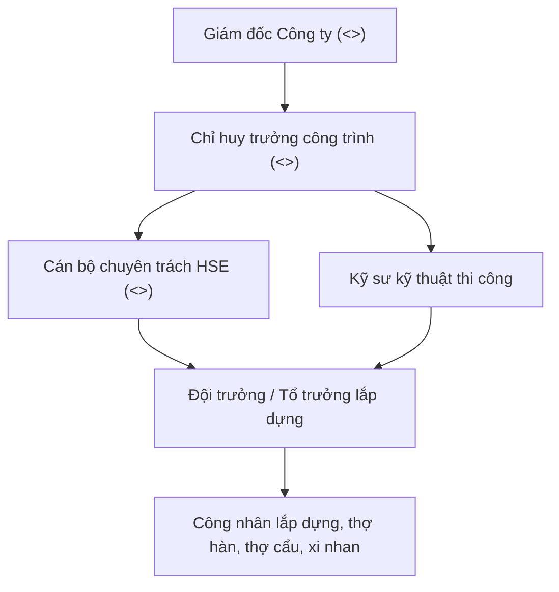

| **<<CTY_TEN>>** Địa chỉ: <<CTY_DC>> Ban Chỉ huy công trường: <<CT_TEN>> | | **CỘNG HÒA XÃ HỘI CHỦ NGHĨA VIỆT NAM** **Độc lập – Tự do – Hạnh phúc** *<<CTY_DIA_DANH>>, ngày …… tháng …… năm 20……* |
|---|---|---|

 

# BIỆN PHÁP BẢO ĐẢM AN TOÀN TRONG THI CÔNG XÂY DỰNG CÔNG TRÌNH
### (Gói thầu: Gia công, vận chuyển và thi công lắp dựng kết cấu thép)
*(Cấu trúc quy chuẩn theo Phụ lục III Nghị định số 207/2026/NĐ-CP ngày 15/06/2026 của Chính phủ)*

---

 

- **Tên dự án / Công trình:** <<CT_TEN>>
- **Địa điểm xây dựng:** <<CT_DIA_DIEM>>
- **Chủ đầu tư / Tổng thầu:** <<KH_TEN>>
- **Nhà thầu thi công:** **<<CTY_TEN>>**
- **Chỉ huy trưởng công trình:** <<CT_CHI_HUY_TRUONG>> &emsp;&emsp; **Cán bộ chuyên trách HSE:** <<CT_AT_VIEN>>

---

## CHƯƠNG I: CĂN CỨ PHÁP LÝ VÀ QUY MÔ THI CÔNG

### 1.1. Căn cứ pháp lý:
- Luật Xây dựng số 135/2025/QH15 ngày 27/06/2025 (đặc biệt Điều 10 về bảo hiểm và Điều 61 về quyền dừng thi công khi mất an toàn);
- Luật An toàn, vệ sinh lao động số 84/2015/QH13 ngày 25/06/2015;
- Nghị định số 207/2026/NĐ-CP ngày 15/06/2026 của Chính phủ quy định về quản lý chất lượng, thi công xây dựng và bảo trì công trình xây dựng (Điều 15 và Phụ lục III);
- Thông tư số 32/2026/TT-BXD ngày 22/06/2026 của Bộ Xây dựng hướng dẫn chi tiết Nghị định số 207/2026/NĐ-CP;
- Quy chuẩn kỹ thuật Quốc gia QCVN 18:2021/BXD về An toàn trong thi công xây dựng;
- Tiêu chuẩn Quốc gia TCVN 170:2007 về Kết cấu thép – Gia công, lắp ráp và nghiệm thu;
- Hợp đồng thi công xây dựng số: ……/20……/HĐTC-<<CTY_TEN_VT>> ký giữa <<KH_TEN>> và <<CTY_TEN>>.

### 1.2. Quy mô công trình và điều kiện hiện trường:
- **Quy mô kết cấu:** Nhà xưởng công nghiệp kết cấu thép khung Zamil / dàn không gian; diện tích sàn: ………… m2; bước cột: …… m; nhịp khung: …… m; chiều cao đỉnh mái: +………… m; chiều cao giọt tranh: +………… m; tổng khối lượng kết cấu thép ước tính: ………… tấn.
- **Điều kiện mặt bằng:** Mặt bằng nền đất đã lu lèn / bê tông lót; cốt cao độ nền hoàn thiện: ±0.000m; khả năng chịu tải của nền đất phục vụ định vị cần trục: tối thiểu ………… tấn/m2.
- **Khu vực lân cận:** Tiếp giáp các công trình lân cận / đường giao thông công cộng / lưới điện hiện hữu (khoảng cách an toàn tối thiểu đến đường dây điện trung, hạ thế: …… mét).

---

## CHƯƠNG II: SƠ ĐỒ TỔ CHỨC VÀ PHÂN CÔNG TRÁCH NHIỆM AN TOÀN

### Phân công trách nhiệm cụ thể:
1. **Chỉ huy trưởng (<<CT_CHI_HUY_TRUONG>>):** Chịu trách nhiệm toàn diện trước Pháp luật, Chủ đầu tư và Giám đốc Công ty về công tác an toàn lao động, vệ sinh môi trường và PCCC tại công trường; phê duyệt Giấy phép làm việc (PTW); dừng ngay công việc khi phát hiện nguy cơ mất an toàn.
2. **Cán bộ chuyên trách HSE (<<CT_AT_VIEN>>):** Giám sát liên tục hiện trường; chủ trì cuộc họp Toolbox Talk đầu giờ; kiểm tra tình trạng thiết bị nâng, dây đai an toàn, cáp cứu sinh lifeline; lập biên bản xử lý vi phạm kỷ luật an toàn; cấp phát và kiểm tra PPE.
3. **Kỹ sư kỹ thuật thi công:** Hướng dẫn biện pháp thi công, bản tính cẩu, kiểm tra độ siết bu lông liên kết và độ ổn định không gian của khung nhà xưởng.
4. **Tổ trưởng lắp dựng & Thợ thi công:** Tuyệt đối tuân thủ quy tắc làm việc trên cao; duy trì liên tục móc dây an toàn; không tự ý tháo dỡ lan can, sàn thao tác, dây cứu sinh.

---

## CHƯƠNG III: NHẬN DIỆN MỐI NGUY VÀ ĐÁNH GIÁ RỦI RO ĐẶC THÙ (JSA/HIRA)

| Công việc | Mối nguy hiểm tiềm ẩn | Mức độ rủi ro | Biện pháp kiểm soát & Loại trừ rủi ro | Trách nhiệm |
|---|---|:---:|---|---|
| **Cẩu lắp cấu kiện thép** | - Lật cẩu, lún chân cẩu - Đứt cáp cẩu, tuột ma ní - Va đập cấu kiện vào người/thiết bị | **Rất cao** | - Bố trí tấm lót tôn/gỗ dày chịu lực dưới chân chống cẩu; - Kiểm định cẩu còn hạn, thử tải cáp trước ca; - Lập Bản tính cẩu (Rigging Plan); buộc dây định hướng (tagline); cấm người đứng trong bán kính quay cẩu. | CHT, HSE, Kỹ sư, Lái cẩu |
| **Làm việc trên cao** | - Ngã cao từ dầm, xà gồ, mái tôn - Rơi vật tư, dụng cụ thi công xuống dưới | **Cực kỳ nguy hiểm** | - 100% căng dây cứu sinh lifeline $\Phi 10$mm thép bọc nhựa dọc dầm; - Sử dụng dây an toàn toàn thân 2 móc có giảm chấn, duy trì quy tắc "1 móc mở - 1 móc luôn khóa"; - Buộc dây giữ dụng cụ thi công (tethering); giăng lưới hứng rơi; lập rào chắn vùng nguy hiểm bên dưới. | CHT, HSE, Tổ thợ lắp dựng |
| **Hàn cắt kim loại** | - Bỏng nhiệt, xỉ hàn rơi - Cháy nổ vật liệu bén lửa - Điện giật từ kìm hàn | **Cao** | - Cấp Giấy phép làm việc nóng (Hot Work Permit); - Che chắn bạt chống cháy cách ly khu vực hàn; - Bố trí bình chữa cháy bột ABC/CO2 tại chỗ; người giám sát hỏa hoạn (Fire Watch). | Thợ hàn, HSE |
| **Điện thi công** | - Rò rỉ điện, điện giật, cháy chập tủ điện tạm | **Cao** | - 100% tủ điện công trường lắp aptomat chống dòng rò ELCB/RCD 30mA; - Đóng cọc tiếp địa đạt $R_{\text{tđ}} \le 4\Omega$; dây cáp điện đi trên cao hoặc bọc ống bảo vệ chôn ngầm. | Thợ điện, HSE |

---

## CHƯƠNG IV: BIỆN PHÁP KỸ THUẬT AN TOÀN CHI TIẾT THEO PHỤ LỤC III NĐ 207

### 4.1. Biện pháp an toàn làm việc trên cao và chống rơi ngã:
1. **Quy chuẩn hệ thống dây cứu sinh (Lifeline):**
   - Trước khi cẩu dầm thép lên vị trí lắp đặt, công nhân phải gắn sẵn hệ thống trụ đỡ cáp cứu sinh và luồn cáp thép $\Phi 10\text{mm}$ dọc theo cánh trên của dầm ngay dưới mặt đất.
   - Cáp lifeline phải được căng bằng tăng đơ cường độ cao, điểm cố định đầu cáp sử dụng tối thiểu 03 cóc kẹp cáp siết đúng chiều; độ võng cho phép giữa 2 điểm neo không vượt quá $3\%$.
2. **Quy tắc sử dụng phương tiện bảo vệ cá nhân chống ngã:**
   - 100% người lao động làm việc từ cao độ $+2.0\text{m}$ trở lên bắt buộc phải mang dây đai an toàn toàn thân (Full Body Harness) loại 2 móc có bộ giảm chấn tiêu chuẩn EN 361.
   - Nguyên tắc kết nối móc an toàn: **Bắt buộc luôn duy trì ít nhất 01 móc khóa vào dây cứu sinh hoặc điểm neo cố định** trong suốt quá trình di chuyển hoặc đổi vị trí thao tác (nguyên tắc "1 mở - 1 móc").
3. **Sàn thao tác, thang leo và rào chắn an toàn:**
   - Tại các vị trí liên kết bu lông nút khung, bố trí sàn thao tác treo chuyên dụng có lan can an toàn 3 thanh (thanh tay vịn cao $1.1\text{m}$, thanh giữa cao $0.6\text{m}$ và tấm chắn chân toe-board cao $0.15\text{m}$).
   - Sử dụng thang nhôm rút chuyên dụng hoặc xe nâng tự hành dạng khớp gập / cần thẳng (Boom lift / Scissor lift) để tiếp cận vị trí thi công; cấm trèo trực tiếp trên thân cột thép khi chưa có thang leo gắn kèm dây cứu sinh thẳng đứng (Vertical Lifeline) kèm khóa hãm trượt chống rơi (Fall Arrester).
4. **Vùng cấm nguy hiểm bên dưới (Barricade Zone):**
   - Thiết lập rào chắn mềm bằng dây phản quang hoặc rào cứng bao quanh toàn bộ khu vực bên dưới khoang đang thi công lắp dựng; treo biển cảnh báo: **"NGUY HIỂM – VÙNG CẨU VÀ LẮP DỰNG TRÊN CAO – CẤM VÀO"**. Tuyệt đối cấm thi công chéo tầng hoặc bố trí người làm việc bên dưới khi trên cao đang lắp dựng kết cấu.

### 4.2. Biện pháp an toàn nâng hạ và cẩu lắp kết cấu thép:
1. **Quy chuẩn thiết bị nâng:**
   - Cần trục phục vụ cẩu lắp (cần trục bánh xích hoặc bánh lốp) phải có đầy đủ Hồ sơ kiểm định kỹ thuật an toàn còn hiệu lực do tổ chức được Bộ Xây dựng / Bộ LĐTBXH cấp phép;
   - Người vận hành cần trục phải có chứng chỉ nghề vận hành cẩu và Thẻ an toàn lao động Nhóm 3 còn hạn;
   - Trước mỗi ca làm việc, Lái cẩu cùng Kỹ sư và Cán bộ HSE kiểm tra hệ thống phanh, cáp tải, móc cẩu, chốt an toàn móc cẩu, thiết bị giới hạn hành trình mỏ cẩu, còi và đèn cảnh báo.
2. **Quy tắc cẩu lắp cấu kiện:**
   - Bắt buộc lập Bản tính cẩu (Rigging Plan) đối với cấu kiện nặng từ 05 tấn trở lên hoặc cấu kiện dầm dài trên 15 mét;
   - Góc hợp bởi các nhánh cáp cẩu không được vượt quá $60^\circ$ (góc đỉnh); sử dụng đệm lót cao su hoặc gỗ tại các vị trí cáp tiếp xúc với góc cạnh sắc nhọn của cấu kiện thép;
   - 100% cấu kiện khi cẩu phải buộc 02 sợi dây định hướng (tagline) ở hai đầu để công nhân đứng dưới mặt đất điều khiển hướng quay của cấu kiện, cấm dùng tay trực tiếp giữ hoặc đẩy cấu kiện đang cẩu lơ lửng.
3. **Ngưỡng thời tiết dừng cẩu:**
   - Trang bị máy đo tốc độ gió cầm tay tại công trường. **Dừng tuyệt đối công tác cẩu lắp trên cao khi tốc độ gió $\ge 10.7\text{ m/s}$ (tương đương Gió cấp 6)**, hoặc khi trời có mưa to, sấm sét, giông lốc hoặc tầm nhìn hạn chế dưới 50 mét.

### 4.3. Biện pháp bảo đảm ổn định không gian công trình trong quá trình lắp dựng:
1. **Lắp dựng khoang giằng cứng đầu tiên:**
   - Luôn luôn chọn khoang có hệ giằng cột và giằng mái để lắp dựng đầu tiên;
   - Tiến hành lắp dựng 02 cột $\rightarrow$ lắp hệ giằng cột $\rightarrow$ cẩu lắp dầm kèo $\rightarrow$ lắp xà gồ và hệ giằng mái $\rightarrow$ siết chặt 100% bu lông và cân chỉnh độ thẳng đứng, cao độ đạt chuẩn thiết kế trước khi cẩu nhả móc;
   - Chỉ được phép tháo móc cẩu khỏi dầm kèo khi dầm đã được liên kết bu lông chắc chắn vào đầu cột và đã có tối thiểu 02 nhánh cáp giằng tạm (Guy Wires) tăng đơ neo giữ chống lật.
2. **Kiểm soát siết bu lông liên kết:**
   - Sử dụng cờ lê lực đã được hiệu chuẩn để kiểm tra lực siết bu lông cường độ cao (bu lông liên kết cột dầm); đánh dấu sơn đỏ lên đầu bu lông sau khi đã kiểm tra đạt lực siết thiết kế.

---

## CHƯƠNG V: KẾ HOẠCH QUẢN LÝ VÀ KIỂM TRA AN TOÀN HẰNG NGÀY

1. **Huấn luyện an toàn và Thẻ an toàn:**
   - 100% công nhân và kỹ sư thi công phải hoàn thành khóa huấn luyện an toàn lao động Nhóm 3 theo Nghị định 44/2016/NĐ-CP và được huấn luyện tiếp nhận nội quy an toàn dự án của Tổng thầu trước khi bước vào công trường.
2. **Họp an toàn đầu ca (Toolbox Talk):**
   - Diễn ra 15 phút đầu mỗi ca làm việc (07h00 sáng); Chỉ huy trưởng và Cán bộ HSE điểm danh quân số, kiểm tra thể trạng sức khỏe (nồng độ cồn, huyết áp thợ cao tuổi), phổ biến nhiệm vụ thi công trong ngày, chỉ rõ các mối nguy hiểm rơi ngã, cẩu và biện pháp phòng ngừa.
3. **Quy trình cấp Giấy phép làm việc (PTW):**
   - Cán bộ kỹ thuật lập Phiếu đề nghị cấp Giấy phép làm việc nguy hiểm (Làm việc trên cao, Cẩu lắp, Làm việc nóng); Cán bộ HSE kiểm tra điều kiện an toàn thực tế tại hiện trường; Chỉ huy trưởng ký phê duyệt Giấy phép trước khi bắt đầu công việc.
4. **Kiểm tra an toàn trước ca (Pre-shift Checklist):**
   - Kiểm tra tình trạng dây an toàn, nón bảo hộ, giày mũi sắt, kính hàn; kiểm tra hệ thống điện tạm, dây nguồn không trầy xước, bình bọt chữa cháy.

---

## CHƯƠNG VI: KẾ HOẠCH ỨNG PHÓ TÌNH HUỐNG KHẨN CẤP VÀ SƠ CẤP CỨU (ERP)

1. **Quy trình xử lý sự cố rơi ngã / tai nạn trên cao:**
   - Người phát hiện hô to **"DỪNG VIỆC"**, thông báo ngay cho Chỉ huy trưởng và Cán bộ HSE;
   - Lực lượng cứu nạn công trường tiếp cận bằng xe nâng người Boom lift hoặc thang cứu nạn, tiến hành đỡ nạn nhân, cố định nẹp cổ và cột sống, hạ nạn nhân xuống đất an toàn;
   - Cán bộ y tế / sơ cấp cứu tiến hành sơ cứu ban đầu, cầm máu, băng nẹp cố định vết thương;
   - Điều động xe cấp cứu công trường chuyển ngay nạn nhân đến cơ sở y tế gần nhất.
2. **Thông tin liên hệ y tế và cứu nạn khẩn cấp:**
   - **Bệnh viện gần nhất tiếp nhận cấp cứu:** <<CT_BENH_VIEN>>
   - **Đường dây nóng cấp cứu Bệnh viện:** **<<CT_BENH_VIEN_DT>>**
   - **Cấp cứu y tế Quốc gia:** 115
   - **Cảnh sát PCCC và Cứu nạn cứu hộ:** 114
   - **Cảnh sát trật tự:** 113
   - **Chỉ huy trưởng công trường (<<CT_CHI_HUY_TRUONG>>):** ……………………………………
   - **Cán bộ chuyên trách HSE (<<CT_AT_VIEN>>):** ……………………………………

---

## CHƯƠNG VII: CAM KẾT VÀ PHÊ DUYỆT

<<CTY_TEN>> cam kết thực hiện nghiêm túc, đầy đủ toàn bộ các biện pháp an toàn nêu trên. Trường hợp xuất hiện thay đổi giải pháp thi công hoặc điều kiện hiện trường có nguy cơ mất an toàn nghiêm trọng, Công ty sẽ chủ động tạm dừng thi công theo đúng quy định tại Điều 61 Luật Xây dựng 2025, cập nhật lại biện pháp và trình Chủ đầu tư / Tổng thầu phê duyệt lại trước khi tiếp tục thi công./.

 

| **CÁN BỘ LẬP BIỆN PHÁP** *(Cán bộ HSE – Ký, họ tên)*     **<<CT_AT_VIEN>>** | **NGƯỜI KIỂM TRA** *(Chỉ huy trưởng – Ký, họ tên)*     **<<CT_CHI_HUY_TRUONG>>** | **NHÀ THẦU THI CÔNG PHÊ DUYỆT** **GIÁM ĐỐC** *(Ký tên, đóng dấu)*     **<<CTY_DAI_DIEN>>** |
|:---:|:---:|:---:|

 

### Ý KIẾN CHẤP THUẬN CỦA TƯ VẤN GIÁM SÁT / TỔNG THẦU / CHỦ ĐẦU TƯ
*(Ký tên, ghi rõ họ tên, chức danh và đóng dấu xác nhận)*

    

**<<KH_DAI_DIEN>>**

